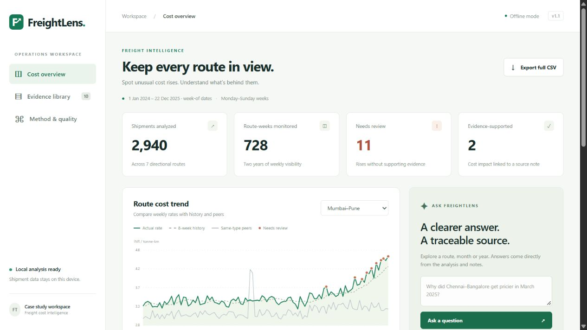
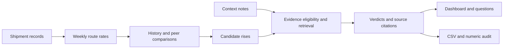

<div align="center">

# FreightLens

### Freight cost intelligence, backed by evidence.

Spot unusual route costs, compare weekly trends, and trace every supported explanation to its source.

[**Explore the live demo ↗**](https://freightlens-two.vercel.app) · [Sample output](results/output.csv) · [10-minute walkthrough](WALKTHROUGH.md)

[](https://github.com/bhavyakeerthi3/freightlens/actions/workflows/ci.yml)


</div>

<a href="https://freightlens-two.vercel.app">
  
</a>

## The problem

Freight rates can rise because of fuel, tolls, weather, seasonal demand—or changes that deserve a closer look. FreightLens turns shipment records into weekly route comparisons and checks whether the supplied context notes support a cost increase.

Built for the FreightTiger Software Engineering Intern case study, it combines a reproducible Python pipeline with an interactive dashboard. Every evidence-supported verdict names the exact note; unsupported rises stay unexplained.

## What you can explore

| Feature | What it shows |
| --- | --- |
| **Route trends** | Weekly rates alongside the route’s history and other routes of the same type. |
| **Weekly findings** | Route, verdict and date filters, pagination, and a full CSV export. |
| **Evidence details** | The calculation, comparison baselines, shipment counts, source note and applicability dates. |
| **Grounded questions** | Answers scoped to a route, month, year or ISO date, using the stored findings. |
| **Evidence library** | All ten supplied notes and their eligibility to explain a rise. |

Try these in the demo:

```text
Why did Chennai-Bangalore get pricier in March 2025?
Show unexplained alerts for Mumbai-Pune in 2025
Show justified alerts in 2025
```

Questions use a deterministic parser and source-backed templates. No language model is called.

## Run locally

**Requires Python 3.10 or later.** No package installation, API keys or frontend build are needed.

```bash
git clone https://github.com/bhavyakeerthi3/freightlens.git
cd freightlens
python demo.py
```

Open **http://127.0.0.1:8000**. The demo generates the analysis before starting. On Windows, you can also double-click `start_demo.bat`. If the port is busy, use `python demo.py --port 8001`.

To generate the submission files without starting the dashboard:

```bash
python assistant.py
```

## How it works



**Measure.** Group shipments by directional route, supplied route type, and Monday–Sunday week. Compute the weekly rate as:

```text
cost per tonne-km = sum(freight cost) / sum(quantity in tonnes × distance in km)
```

**Compare.** History is the mean of observed weekly rates in the eight calendar weeks strictly before the current week. Peers are the other routes of the same type in that same week. Missing weeks are not padded, and a route is excluded from its own peer average.

**Flag.** A candidate must rise from the prior observed week and exceed either baseline by **more than 20%**. This threshold is a project policy, not a requirement specified by the brief.

**Explain.** Reviewed route, date, impact and magnitude rules gate local TF-IDF retrieval. An eligible positive note supports a `No (justified)` verdict; a candidate without support remains `Yes` for review. Other weeks receive `No`.

See [methodology and validation](docs/METHODOLOGY.md) for exact definitions, evidence windows and trade-offs.

## Results on the supplied data

| Shipments | Routes | Route-weeks | Needs review | Evidence-supported |
| :---: | :---: | :---: | :---: | :---: |
| **2,940** | **7** | **728** | **11** | **2** |

The remaining **715 route-weeks** do not trigger the alert policy. These counts describe the configured policy’s output, not accuracy against an independently labeled anomaly dataset.

## Verification

```bash
python verify.py
```

- **21 automated tests**, including 14 labeled evidence subcases: weekly arithmetic, baselines, date boundaries, unsupported notes, question scope, HTTP responses and CSV export.
- **Three fresh CLI runs** with byte-identical output CSVs, numeric audits and cost logs in the same environment.
- **GitHub Actions** runs the same verification on Python 3.10 and 3.12.
- **Zero model calls, zero LLM tokens, $0 API spend** for the analysis. Local compute and hosting costs are excluded.

[Test results](results/evaluation.txt) · [Reproducibility hashes](results/reproducibility.json) · [Cost log](results/cost_log.json) · [Browser verification](results/verification.md)

## Submission files

| File | Purpose |
| --- | --- |
| [output.csv](results/output.csv) | All 728 route-weeks in the exact eight-column submission format. |
| [audit.json](results/audit.json) | Unrounded baselines, deltas, sample counts and evidence. |
| [cost_log.json](results/cost_log.json) | Model-call, token and cost accounting. |
| [reproducibility.json](results/reproducibility.json) | Hash comparisons across three independent runs. |
| [WALKTHROUGH.md](WALKTHROUGH.md) | Timed guide for the 10-minute project demonstration. |

## Project map

```text
├── assistant.py            # Weekly analysis, validation and evidence retrieval
├── questions.py            # Grounded route/date question engine
├── demo.py                 # Local HTTP server
├── index.html              # Dashboard views
├── app.css / app.js         # Styling, charts and interactions
├── reviewed_evidence.json  # Exact source rows bound to reviewed annotations
├── data/                   # Supplied shipment records, notes and output contract
├── results/                # Generated output and verification evidence
├── test_*.py / verify.py    # Tests and reproducibility harness
├── api/index.py            # Read-only Vercel function
├── public/                 # Prepared production assets
└── docs/METHODOLOGY.md      # Detailed assumptions and calculation definitions
```

**Stack:** Python standard library · HTML/CSS/JavaScript · SVG charts · Vercel · GitHub Actions.

## Deploy updates

The [public demo](https://freightlens-two.vercel.app) serves static assets from Vercel’s CDN and uses a read-only Python function for findings and questions. It publishes the supplied synthetic sample data.

```bash
python assistant.py
python verify.py
python prepare_vercel.py
vercel --prod
```

Authenticate with your Vercel account and select the intended project when linking. The deployment reads a packaged analysis snapshot; changing the data requires regenerating it and redeploying. No runtime filesystem writes or model credentials are required.

## Scope and trade-offs

The 20% rule can miss gradual rises and expensive plateaus. Evidence windows are explicit annotations for this small corpus, and weekly overlap does not prove every shipment was affected. A supporting note establishes a plausible cost impact, not that the entire increase is reasonable.

The question engine supports routes, explicit periods and verdict summaries. It does not provide general natural-language reasoning. Retrieval uses TF-IDF and templates, with no generative model or hosted vector database. Full assumptions and improvement opportunities are documented in [the methodology](docs/METHODOLOGY.md).
