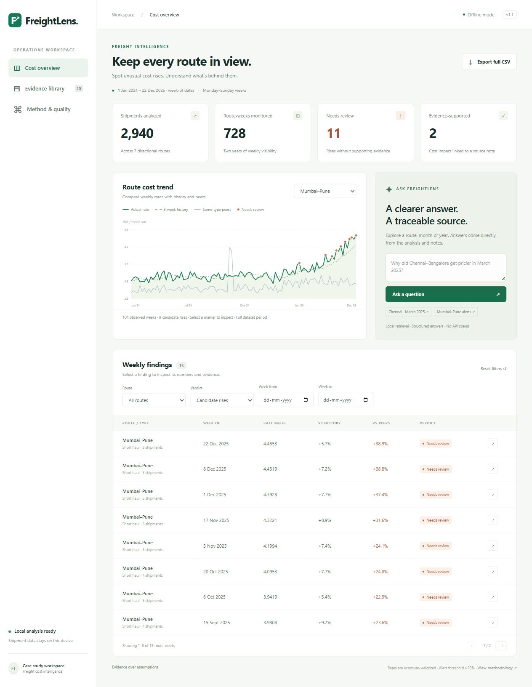

# FreightLens

### Explainable freight cost intelligence

A complete local project with a responsive dashboard, interactive route trends, searchable weekly findings, source-note evidence, date-aware questions, and an auditable CSV pipeline.

**Public production demo:** https://freightlens-two.vercel.app

**Source repository:** https://github.com/bhavyakeerthi3/freightlens



The Vercel deployment serves static assets from its CDN and uses a read-only Python function for the analysis and grounded questions. It publishes the supplied synthetic sample data; no API credentials or language model are needed.

An offline assistant that finds rising route costs, compares them with exact weekly baselines, and cites only applicable cost-impact evidence. No credentials, packages, or network access are required. Python 3.10+.

## Run

From this folder:

```sh
python assistant.py
python verify.py
python demo.py
```

To get a fresh copy first:

```sh
git clone https://github.com/bhavyakeerthi3/freightlens.git
cd freightlens
```

The last command serves the demo at http://127.0.0.1:8000. Stop with Ctrl+C. The first two commands generate results and validate the submission. On Windows, `py` can replace `python`, or double-click `start_demo.bat` and open the displayed URL. If port 8000 is occupied, use `python demo.py --port 8001`.

## Deploy updates to Vercel

After editing code or data, regenerate the analysis, validate it, and refresh the public assets:

```sh
python assistant.py
python verify.py
python prepare_vercel.py
vercel --prod
```

Deploy from this project folder and select the `bk` team / `freightlens` project when linking. `vercel.json` supplies the static output directory, API rewrites and response headers. `.vercel/` is intentionally excluded from the submission; authenticate with your own Vercel account. The function reads the packaged analysis snapshot without writing to Vercel's filesystem. New data requires a new analysis and deployment.

## Explore the project

- **Cost overview:** four dataset metrics; weekly actual, history and peer trend lines; selectable alert markers; route, verdict and date filters; paginated findings; full CSV download.
- **Finding details:** unrounded-source numeric comparisons, sample counts, the decision explanation, the exact source note and reviewed applicability dates.
- **Ask FreightLens:** route and month/year questions, ISO dates, and verdict summaries answered from stored analysis. Try `Why did Chennai-Bangalore get pricier in March 2025?` or `Show justified alerts in 2025`.
- **Evidence library:** all ten original notes with a clear distinction between applicable positive evidence and notes that cannot justify a rise.
- **Method & quality:** calculation definitions, decision policy and reproducibility commands inside the app.

The dashboard uses plain HTML/CSS/JavaScript and an SVG chart, with no CDN assets, build step, npm installation, or runtime package dependencies. Table filters affect the findings; the trend chart has its own route selector and always shows the full dataset period. The top summary cards always describe the full dataset.

```text
freight_assistant/
  assistant.py              # Input validation, weekly pipeline and evidence retrieval
  questions.py              # Grounded route/date/verdict question parser
  demo.py                   # Local HTTP API and static assets
  api/index.py, vercel.json  # Read-only Vercel function and production routing
  prepare_vercel.py, public/ # Generated CDN assets and CSV download
  index.html, app.css, app.js # Responsive interface and interactive chart
  reviewed_evidence.json    # Exact source rows bound to reviewed annotations
  data/                     # Unmodified supplied CSV files
  results/                  # Output, audit, evals and reproducibility evidence
  test_*.py, verify.py       # Regression, HTTP and reproducibility checks
  WALKTHROUGH.md            # Ten-minute presentation guide
```

Custom inputs: `python assistant.py --data PATH_TO_DATA --out PATH_TO_RESULTS`. Input filenames and column names must match the supplied files. The reviewed evidence registry deliberately applies only to the supplied notes; new or changed notes require review before they can justify a rise.

## Deliverables

- `results/output.csv`: exact eight columns and order from `sample_output_format_v2.csv`, including `matched_note_id`. One row per observed route/type/week, including normal weeks. Costs use six decimal places; comparison strings use signed one-decimal percentages, following the sample. Unavailable comparisons are `N/A`; unsupported note IDs are blank.
- `results/audit.json`: unrounded numeric baselines, deltas, sample counts, and candidate status for audit and demo.
- `results/evaluation.txt`: executable evaluation results.
- `results/reproducibility.json`: SHA-256 comparisons across three separate CLI processes.
- `results/cost_log.json`: actual token/call/cost accounting.
- `WALKTHROUGH.md`: a timed 10-minute demo guide.

## Core calculations

1. Parse dates and map each to Monday; Sunday remains in the preceding Monday's week. Group by directional origin-destination plus the supplied route_type. Do not infer distance buckets.
2. Weekly cost = sum(freight_cost_inr) / sum(quantity_tonnes * distance_km). This exposure-weighted ratio avoids giving a tiny shipment the same influence as a large one. It is not a mean of individual shipment rates, or the product of summed quantities and summed distances.
3. History = arithmetic mean of that group's observed weekly rates in the eight calendar weeks strictly before the current Monday. Use every available prior week when fewer than eight exist; no padding, extrapolation, current-week leakage, or zero-filled missing weeks. No history means `N/A`.
4. Peers = arithmetic mean of the other route groups' weekly rates of the same route_type in the same week, excluding the current route. No peers means `N/A`. This dataset has a consistent type per route.
5. Delta = current / baseline - 1. Decisions use full precision, not displayed rounded strings. A zero baseline is treated as unavailable.

## Alert policy (a documented design choice)

The brief does not prescribe an anomaly threshold. A candidate must rise above its most recent observed weekly rate AND exceed either baseline by strictly more than 20%. The first observation cannot establish a rise. This conservative, interpretable policy is not a statistically calibrated significance test. It can miss gradual inflation, stable expensive plateaus, and downward corrections that remain overpriced. With gaps, the rise comparison is to the prior observed week, while the history window stays eight calendar weeks.

An applicable positive note changes a candidate from `Yes` to `No (justified)`. Normal weeks are `No`. All candidates remain visible in the demo, including justified ones. A note supports a plausible cost impact, not proof that every rupee of an increase is reasonable.

## Retrieval and grounding

The supplied corpus has ten notes. `NoteIndex` implements local TF-IDF vectors and cosine similarity; date, route, impact, and magnitude gates establish eligibility before ranking. This is a lightweight vector retrieval and template-generation pipeline, with no hosted vector database or generative model. I chose auditable grounding over adding an LLM that could alter verdicts. It should not be presented as an LLM-based system.

The three positive notes have explicit evidence windows reviewed against their supplied text. `reviewed_evidence.json` binds each annotation to the exact supplied row; a changed note with a reused ID fails closed. These annotations were prepared as part of this implementation, not externally validated by a domain expert.

- N001: Chennai-Bangalore, Feb 24-Mar 8, 2025, inclusive. A week overlapping this interval can cite it; Mar 10 cannot. Weekly overlap is a coarse approximation and does not prove every shipment was affected.
- N002: Ahmedabad-Mumbai, Jan 20-26, 2025, interpreting the note's 'festival week' as the Monday-Sunday publication week.
- N003: all routes, May 5-11, 2025. Conservatively restrict the vague 'starting this week' language to its publication week; do not assume indefinite duration. Its stated 5-7% impact cannot fully justify a rise above 7% versus history. It can be retrieved for smaller increases, but the alert policy may produce no candidate for those.
- N004-N010 cannot justify rises: wrong affected routes, no material cost effect, improved conditions, normal operations, recovery, or absorbed compliance costs.

Future notes cannot justify earlier weeks. No supporting note means unexplained, without guessing an alternative cause. Exact note text, publication date, ID and interpreted validity window appear in justified reasons. No external facts are added.

This is intentionally a small-corpus implementation: manual annotations would need an explicit review workflow at scale. A future LLM could propose structured impact/date annotations, with review and deterministic gates retained; that integration is not implemented here. Similarity is useful for retrieval ordering but contributes little when only one eligible note exists.

## Verification and observed results

The complete supplied input produces 728 route-weeks: 715 normal, 11 unexplained alerts, and 2 evidence-supported candidate rises. These are policy results, not externally labeled anomaly ground truth.

`python verify.py` runs 21 automated tests, including 14 labeled evidence subcases, weighted aggregation, Sunday/Monday boundaries, short/missing history, exact peer exclusion, future-data isolation, invalid input, full-output schema, and citation/verdict consistency. Regression tests cover configurable-threshold explanations, changed notes, month/date questions, ambiguous requests, live HTTP endpoints, unknown-URL errors and the exported CSV. The labeled evidence cases are derived from the same provided notes, not a held-out dataset; passing them validates the grounding rules rather than real-world precision or recall. The suite then runs the full pipeline in three fresh processes and compares CSV, numeric audit and cost-log bytes. The saved hashes match.

GitHub Actions runs this same verification on Python 3.10 and 3.12 for pushes and pull requests. Reproducibility means identical runs in the same environment; numeric audit JSON hashes can differ between operating systems because text-file line endings differ. CSV bytes are explicitly preserved in Git with `.gitattributes`.

No random operations occur. There are zero model calls, zero input/output LLM tokens, and $0 model/API spend for one full run. A published model rate is not applicable because no model is called; local compute costs are excluded. Reproduction logs record output hashes rather than timestamps to keep artifacts deterministic.

## Engineering choices and limits

Standard library only; fail fast on invalid amounts, nonfinite numbers, unknown route types and duplicate shipment IDs. Input order is retained within sums, output keys are sorted, and all decisions are deterministic for unchanged input. The simple baseline scans favor readability over scale (quadratic in route-weeks); precomputed sliding windows and per-week peer totals would be the next optimization. No claims of causal inference, learned anomaly detection, or general natural-language reasoning.

The question engine recognizes route names with spaces or hyphens (including typographic dashes), one month name/abbreviation with optional year, one ISO date mapped to its Monday, and words such as `unexplained`, `justified` or `summary`. Date filters refer to Monday `week_of`, not individual shipment dates. A month without a year explicitly includes all years. Multiple routes or periods request clarification; arbitrary natural-language reasoning is unsupported. Answers quote stored facts and exact note text. Do not use this as an automatic payment-blocking system.

The HTTP server binds only to 127.0.0.1 and serves an explicit asset allowlist. Unknown paths return JSON 404s, oversized questions return 400s, and the UI displays server/network errors. It is a local demo server, not a production deployment.

## Build approach

Implemented the contract and arithmetic first, then explicit evidence annotations and local vector retrieval, followed by the evaluation and independent-run harness. The polished demo adds an interactive investigation flow without changing the original grading CSV or default alert decisions. The job description provides context only; it does not add deliverable requirements. The sample-data demo is now public on Vercel at the user's request; no submission has been sent to HR.
